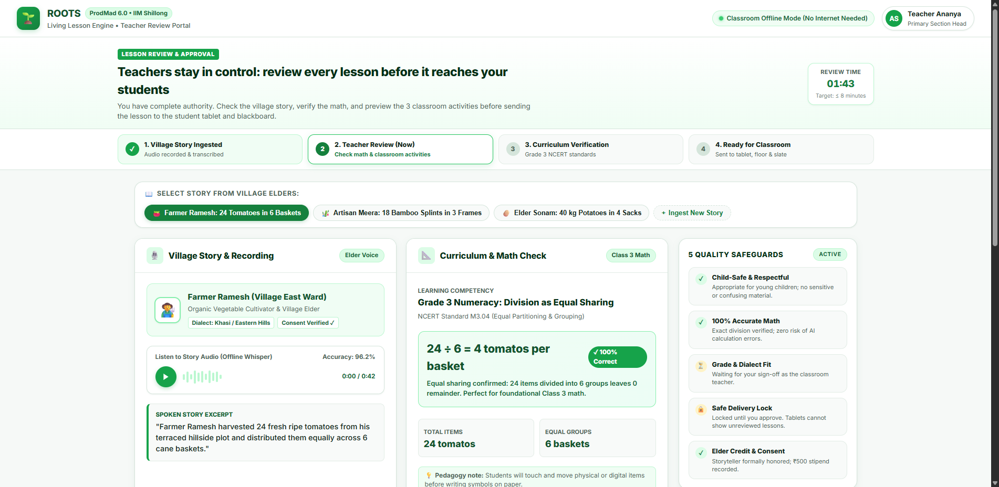
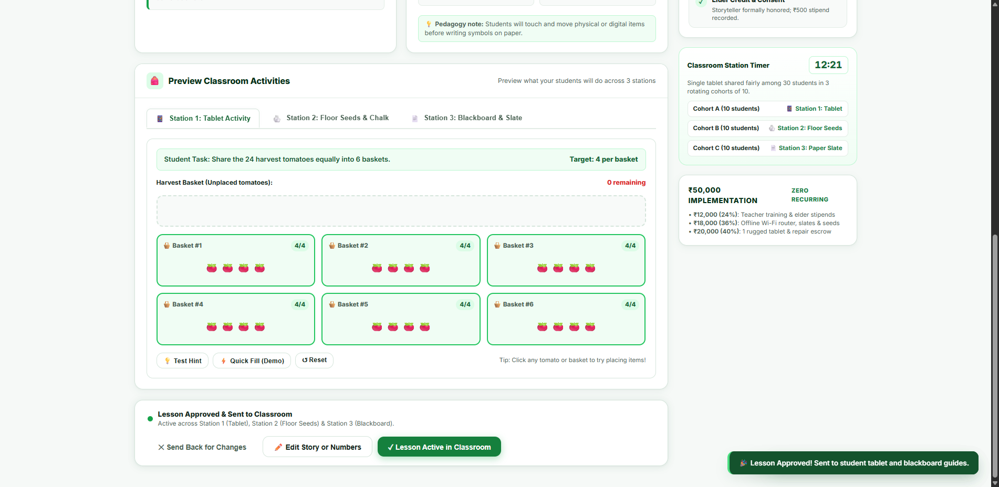

# ROOTS — Living Lesson Engine
### Teacher Review & Approval Portal (ProdMad 6.0 Slide 06 Prototype)
**Case Study: "The Village Beyond the Signal"**  
*Organized by IIM Shillong & biTeSys*


*Clean, light-green teacher dashboard designed specifically for primary school educators in rural mountain villages.*


*Post-approval state: 24 tomatoes partitioned equally into 6 baskets (4 in each), with instant broadcast to student tablets, floor seeds, and blackboard.*

---

## 🌿 Design Rationale: Light Green Aesthetic & Teacher-First Usability
Rooted in the **IIM Shillong & biTeSys case study**, this prototype is designed from the ground up for a **primary school teacher**:
- **Fresh Light Green Aesthetic**: Soothing leafy tones (`#15803d`, `#16a34a`, `#dcfce7`, `#f0fdf4`) that feel educational, welcoming, and gentle on the eyes.
- **Zero Technical Jargon**: No raw code snippets, syntax dumps, or confusing developer terms. Everything is presented in clear, reassuring, classroom-ready terms:
  - *"Math Check: 24 ÷ 6 = 4 tomatoes per basket (100% correct, zero errors)"*
  - *"Class 3 NCERT Standard M3.04 (Equal Partitioning & Grouping)"*
  - *"5 Quality & Safety Safeguards: All verified"*
- **Human-in-the-Loop Governance (Slide 06)**: The teacher holds absolute authority to inspect the story, test student activities, edit numbers, and approve or reject before anything reaches children.

---

## 🎒 The 3 Classroom Learning Formats (Tri-Modal Preview)
Because the village school has **only 1 shared laptop and 1 tablet for 30 students**, the lesson is delivered across 3 simultaneous stations (Slide 07):

1. 📱 **Station 1: Interactive Tablet Activity**:
   - A cheerful digital manipulative where students share 24 harvest tomatoes into 6 cane baskets.
   - Live visual counter (`4/4`) with gentle celebratory audio when all baskets are equally filled.
   - Scaffolded hints that guide the student without giving away the answer.
2. 🪨 **Station 2: Floor Seeds & Chalk Activity**:
   - 100% screen-free tactile task using 24 tamarind seeds / river pebbles and 6 chalk circles on the classroom floor.
   - Peer roles: *The Counter*, *The Distributor*, and *The Checker*.
   - Oral discussion prompts in the local village dialect.
3. 📄 **Station 3: Blackboard & Worksheet**:
   - Printable or copyable blackboard guide.
   - Features an independent transfer question (*"What if Farmer Ramesh had 30 tomatoes across 5 baskets?"*) to verify true understanding over rote memorization.

---

## 🛡️ 5 Quality Safeguards (Teacher Checklist)
1. **Child-Safe & Respectful**: Village story checked for age-appropriateness and cultural resonance.
2. **100% Accurate Math**: Automatic calculation checks guarantee equal division without errors.
3. **Grade & Dialect Fit**: Teacher confirms suitability for Class 3 children and local linguistic nuances.
4. **Safe Delivery Lock**: Student tablets are locked and will never display unapproved lessons.
5. **Elder Credit & Consent**: Storyteller is formally credited and their ₹500 honorarium is logged from the adoption budget.

---

## ⏱️ Live Classroom Station Rotation (15-Minute Timer)
To prevent device bottlenecks, the 30 students rotate across the 3 stations in cohorts of 10 every 15 minutes:
- **Cohort A (10 students)**: Station 1 (Tablet Activity)
- **Cohort B (10 students)**: Station 2 (Floor Seeds & Chalk)
- **Cohort C (10 students)**: Station 3 (Blackboard & Slate)

---

## 🚀 How to Run the Prototype

### Option 1: Instant Static Launch (Zero Installation)
Simply double-click or open `index.html` in any web browser. It runs completely offline with zero server requirements.

### Option 2: Local Offline Server
```bash
python server.py
```
Then navigate to: `http://127.0.0.1:8000`

---

## 📂 Repository Contents
```
prototype-prodmad-/
├── index.html                    # Light-green teacher review dashboard
├── app.js                        # Interactive state, tablet simulation & audio
├── styles.css                    # Professional light-green design system
├── server.py                     # Offline edge server (Python standard library)
├── verify_engine.py              # Math verification logic
├── mock_data.json                # Elder stories & curriculum mappings
├── screenshot_teacher_light.png  # Pre-approval dashboard screenshot
├── screenshot_approved_bottom.png# Post-approval active lesson screenshot
└── README.md                     # Documentation & case study alignment
```

---
*Created for ProdMad 6.0 | ROOTS: Living Lesson Engine | Case Study: The Village Beyond the Signal.*
