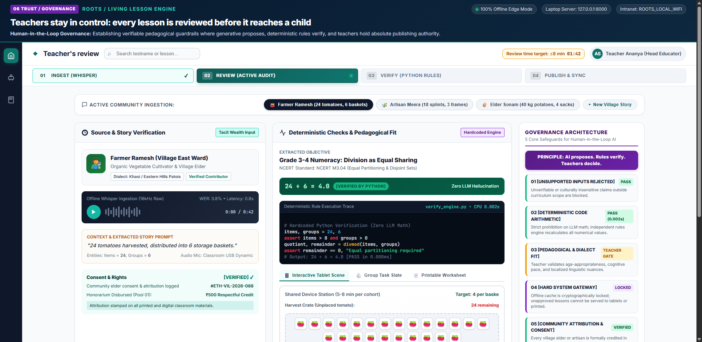
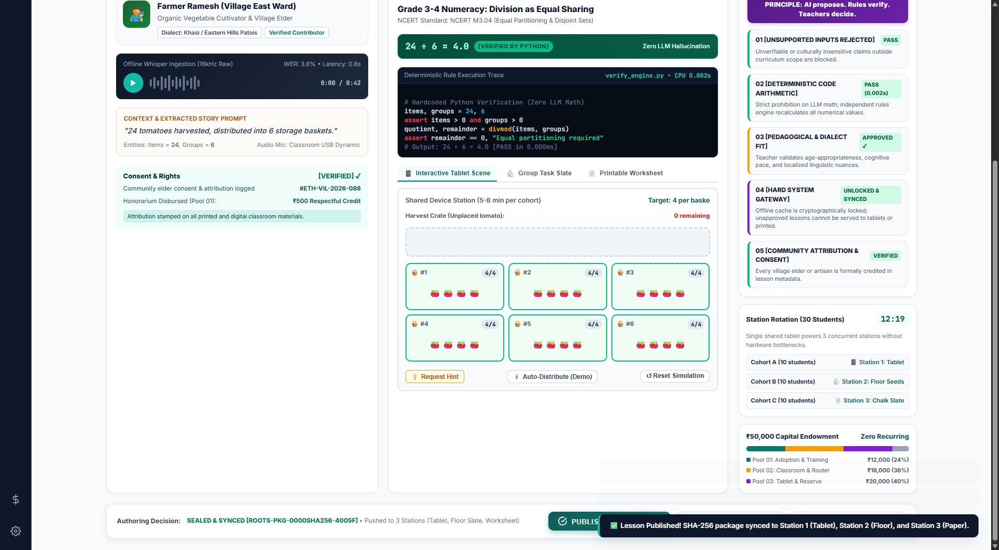

# ROOTS — Living Lesson Engine
### Teacher Audit & Approval Console (Slide 06 Core Hero Interface)
**ProdMad 6.0 Case Study: "The Village Beyond the Signal"**  
*Organized by IIM Shillong & biTeSys*


*Interactive Teacher Audit & Approval Console running with zero cloud latency on the village laptop.*


*Post-audit state: 24 tomatoes partitioned equally into 6 baskets, SHA-256 package sealed, and pushed to 3 classroom stations.*

---

## 🌄 The Context & The Mad Problem
Deep in the mountains of Northeast India, a remote village school operates with:
- **Exactly 1 standard laptop** and limited shared tablets/smartphones.
- **Intermittent, slow, expensive internet** (no continuous cloud LLM calls).
- **Multi-grade classrooms** with diverse attention spans, baseline math/English skills, and local dialects.
- **Deep tacit wealth**: Community elders, farmers, and artisans carry generations of oral history, agricultural science, and geometry that never appear in textbooks.
- **₹50,000 one-time capital endowment** with a strict rule: **₹0 recurring cloud cost**, and at least **₹10,000** dedicated to community adoption and training.

---

## 🏛️ Slide 06 Prototype: Teacher Audit & Approval Console
The visual prompt book establishes the foundational governance thesis:
> **"Teachers stay in control: every lesson is reviewed before it reaches a child."**  
> *Human-in-the-Loop Governance: AI proposes. Rules verify. Teachers decide.*

This prototype is a faithful, production-grade, interactive implementation of the **Teacher Audit & Approval Console (Page 06 Hero Interface)**, coupled with the **3-Station Rotational Delivery Architecture** from Slide 07, the **5 Core Safeguards**, and the **₹50,000 budget allocation**.

---

## 🎯 Key Features & Interactive Architecture

### 1. 4-Stage Conversion Pipeline Stepper
- `01 INGEST`: Local Whisper offline speech-to-text with village dialect normalization (Khasi / Eastern Hills).
- `02 REVIEW (ACTIVE AUDIT)`: Active stage with audit stopwatch targeting **≤8 min** conversion time.
- `03 VERIFY`: Hardcoded Python rules engine execution preventing math hallucination.
- `04 PUBLISH`: Cryptographically locked SHA-256 package synced to classroom stations.

### 2. Left Column: Source & Story Verification
- **Elder / Contributor Card**: Farmer Ramesh (Village East Ward) with bio, dialect tags, and attribution metadata.
- **Offline Audio Player**: Built-in speech synthesis / audio playback with interactive animated waveform visualizer.
- **Context & Story Extraction**: `"24 tomatoes harvested, distributed into 6 storage baskets"`.
- **Consent & Rights Gateway**: Formal elder consent logged (`#ETH-VIL-2026-088`) and honorarium disbursement recorded from Pool 01.

### 3. Right Column: Deterministic Checks & Pedagogical Fit
- **Extracted Objective**: Mapped directly to **NCERT M3.04 (Division as Equal Sharing)**.
- **Deterministic Math Verification Banner**:
  - `Code Output: 24 ÷ 6 = 4.0 [VERIFIED BY PYTHON] | Zero LLM Hallucination`
  - Expandable Python verification code inspector showing hardcoded rule execution on local CPU in `<0.003s`.
- **Tri-Modal Classroom Output Previews**:
  1. 📱 **Interactive Tablet Scene (Shared Device Station)**:
     - Interactive digital manipulative with 6 cane baskets and 24 draggable harvest tomatoes.
     - Live counter per basket tracking equal distribution.
     - **Scaffolded Hint Logic** (Slide 05 Micro-Rule): Withholds hints until an authentic first trial is attempted.
     - Demo Auto-Solve & Reset simulation buttons.
  2. 🪨 **Group Task Slate (Physical Tactile Station)**:
     - Floor activity protocol using 24 tamarind seeds / river pebbles and 6 chalk circles.
     - Student peer roles: Counter, Distributor, Verifier.
     - Oral articulation prompt in local dialect.
  3. 📄 **Printable Worksheet & Blackboard Guide (Evaluation Station)**:
     - Slate blackboard design.
     - Core problem + novel transfer challenge (`"What if Farmer Ramesh had 30 tomatoes across 5 baskets?"`) testing generalized mastery over rote recall.
     - 1-click Print/Export.

### 4. Right Sidebar: Governance Architecture & 5 Core Safeguards
1. **01 [UNSUPPORTED INPUTS REJECTED]**: Rejection of claims outside curriculum boundary.
2. **02 [DETERMINISTIC CODE ARITHMETIC]**: Hardcoded Python arithmetic eliminating LLM math errors.
3. **03 [PEDAGOGICAL & DIALECT FIT]**: Teacher sign-off on dialect bridge and cognitive level.
4. **04 [HARD SYSTEM GATEWAY]**: Cryptographically sealed offline cache (`ROOTS-PKG-SHA256-...`).
5. **05 [COMMUNITY ATTRIBUTION & CONSENT]**: Formal credit and honorarium tracking for village elders.

### 5. Multi-Story Ingestion Switcher & Simulator
Switch seamlessly between:
- 🍅 **Farmer Ramesh**: 24 tomatoes in 6 baskets (Agricultural Science → Division).
- 🎋 **Artisan Meera**: 18 bamboo splints in 3 chevron frames (Artisanal Geometry → Symmetry & Ratios).
- 🥔 **Elder Sonam**: 40 kg potatoes in 4 jute sacks (Economics → Measurement & Partitioning).
- ➕ **New Story Creator**: Ingest custom elder stories with real-time extraction and verification.

### 6. Station Rotation & Budget Tracking Widgets
- **15-Minute Station Rotation Live Timer** (Slide 07): Manages 3 cohorts of 10 students (30 students total) rotating between Tablet, Floor seeds, and Slate without device bottlenecks.
- **₹50,000 Budget Bar** (Slide 09): Visual breakdown of Pool 01 (₹12k), Pool 02 (₹18k), and Pool 03 (₹15k + ₹5k reserve).

---

## 🚀 How to Run the Prototype

### Option A: Direct Static Launch (Zero Install)
Simply double-click or open `index.html` in any modern web browser (Chrome, Edge, Firefox, Safari).
No installation, no internet, and no server required!

### Option B: Local Offline Edge Server (Simulating Village Laptop Node)
To run the local HTTP edge node (Slide 07 Layer 2) with the Python API:
```bash
python server.py
```
Then open your browser to:
```
http://127.0.0.1:8000
```

### Option C: Run Deterministic Verification CLI
You can test the hardcoded Python verification engine directly from the command line:
```bash
python verify_engine.py 24 6
python verify_engine.py 30 5
```

---

## 🎨 Color Palette & Visual Identity
- **Deep Forest Pine & Emerald** (`#0f5c58`, `#0f766e`, `#14b8a6`): The mountain terrain of Northeast India and living natural knowledge.
- **Governance Violet** (`#581c87`, `#7e22ce`): Trust, human authority, and institutional safeguards (Slide 06).
- **Harvest Saffron & Ochre** (`#d97706`, `#f59e0b`): Mandi harvest and village warmth.
- **Tomato Coral** (`#ef4444`): Harvest markers and interactive tokens.
- **Chalkboard Slate** (`#1b2824`): Classroom resilience and zero-electricity blackboard fallbacks.

---

## 📦 Repository Structure
```
prototype-prodmad-/
├── index.html          # Teacher Audit & Approval Console UI (Slide 06)
├── app.js              # Reactive state, tablet simulation, timers, Web Audio
├── styles.css           # Custom design system, typography, animations
├── verify_engine.py    # Deterministic Python math & schema validation engine
├── server.py           # 100% offline local server (Python standard library)
├── mock_data.json      # Structured dataset of village stories & NCERT mapping
└── README.md           # Documentation & design rationale
```

---
*Created for ProdMad 6.0 | ROOTS: Living Lesson Engine | Northeast India Rural Education Initiative.*
