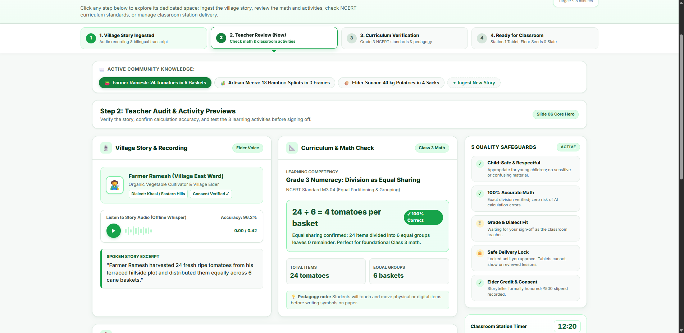
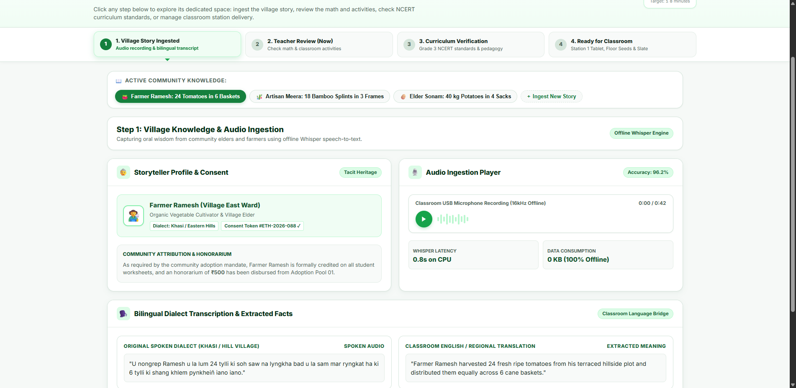
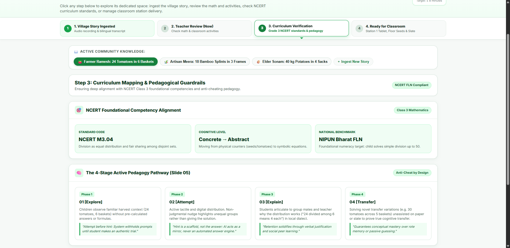
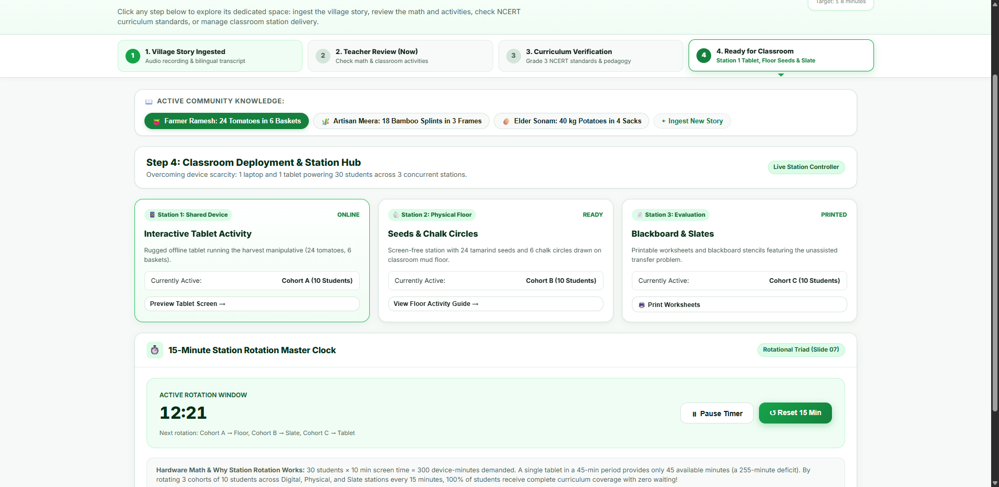

# ROOTS — Living Lesson Engine
### Multi-Space Teacher Review & Approval Portal (ProdMad 6.0 Prototype)
**Case Study: "The Village Beyond the Signal"**  
*Organized by IIM Shillong & biTeSys*


*Step 2 (Core Hero): Interactive Teacher Review & Output Previews with light-green aesthetic.*

---

## 🗺️ 4 Dedicated Clickable Spaces
The top workflow stepper is now **fully interactive and clickable**. Clicking any of the 4 steps smoothly navigates to its own dedicated workspace:

| Step | Dedicated Space | What the Teacher Can Do |
| :--- | :--- | :--- |
| **1** | [**`1. Village Story Ingested`**](screenshot_space_1_ingest.png) | Inspect the storyteller profile, listen to the offline audio recording with animated waveform, view the bilingual dialect translation (Khasi <-> English), and check the community honorarium log. |
| **2** | [**`2. Teacher Review (Now)`**](screenshot_space_2_review.png) | The **Slide 06 Core Hero Interface**: Verify math calculation accuracy (`24 ÷ 6 = 4 tomatoes per basket`), test the interactive tablet simulation (drag/click 24 tomatoes into 6 baskets), preview the floor seed activity and blackboard worksheet, and click **Approve & Send to Classroom**. |
| **3** | [**`3. Curriculum Verification`**](screenshot_space_3_curriculum.png) | Check the **NCERT Class 3 Foundational Competencies (M3.04)**, inspect the **4-Stage Active Pedagogy Pathway** (*Explore → Attempt → Explain → Transfer* from Slide 05), and review anti-cheating guardrails. |
| **4** | [**`4. Ready for Classroom`**](screenshot_space_4_classroom.png) | Manage the **3 Concurrent Classroom Stations** (Tablet, Floor Seeds, Blackboard), run the **15-Minute Station Rotation Master Clock** (with Pause/Reset controls), print student worksheets, and inspect offline intranet topology. |

---

## 📸 Screenshots of All 4 Spaces

### Step 1: Village Story & Audio Ingestion


### Step 2: Teacher Audit & Activity Previews (Slide 06 Hero)


### Step 3: NCERT Curriculum & Active Pedagogy Matrix


### Step 4: Classroom Stations & 15-Minute Rotation Master Clock


---

## 🌿 Light Green Aesthetic (IIM Shillong & biTeSys Palette)
- **Primary Green & Mint Foliage** (`#15803d`, `#16a34a`, `#dcfce7`, `#f0fdf4`): Inspired by the hills of Northeast India and IIM Shillong's visual identity.
- **Zero Technical Jargon**: No raw code blocks or engineering dumps—everything is written in warm, encouraging, human language suitable for primary school educators.
- **Human-in-the-Loop Governance**: Teachers maintain complete authority over what reaches student devices.

---

## 🚀 How to Run the Prototype

### Option 1: Direct In-Browser (Zero Install)
Simply double-click or open `index.html` in any modern web browser. You can navigate between sections using the clickable stepper or direct hash links:
- `index.html#ingest` (Step 1)
- `index.html#review` (Step 2)
- `index.html#curriculum` (Step 3)
- `index.html#classroom` (Step 4)

### Option 2: Local Offline Server
```bash
python server.py
```
Open: `http://127.0.0.1:8000`

---

## 📂 Repository Contents
```
prototype-prodmad-/
├── index.html                    # 4 dedicated spaces & clickable stepper
├── app.js                        # Multi-space navigation, tablet simulation & audio
├── styles.css                    # Light-green design system & responsive layout
├── server.py                     # Offline edge server (Python standard library)
├── verify_engine.py              # Deterministic math engine
├── mock_data.json                # Elder stories & curriculum mappings
├── screenshot_space_1_ingest.png # Step 1 Ingestion screenshot
├── screenshot_space_2_review.png # Step 2 Review screenshot
├── screenshot_space_3_curriculum.png # Step 3 Curriculum screenshot
├── screenshot_space_4_classroom.png  # Step 4 Classroom screenshot
└── README.md                     # Complete documentation & navigation guide
```

---
*Created for ProdMad 6.0 | ROOTS: Living Lesson Engine | Case Study: The Village Beyond the Signal.*
